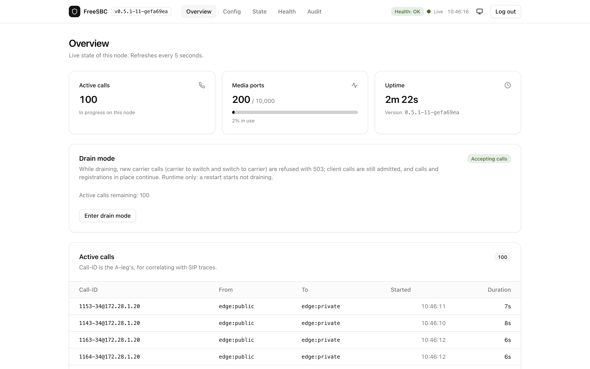

# FreeSBC

An open-source SIP/WebRTC edge proxy with the Caddy experience: **one binary, one YAML file, `./freesbc run`.**

[](LICENSE) [](go.mod)

- **One static Go binary, nothing else to run**: no database, no Redis, no kernel modules, and **no external media process**.
- **Keeps your switch off the public internet**: FreeSBC is the only element with a public address; FreeSWITCH or Asterisk stays on a private LAN and only ever talks to FreeSBC.
- **Phones, browsers and carriers through one public address**: SIP over UDP, TCP and TLS, WebRTC over WS/WSS, and carriers.
- **Built for the open internet**: per-IP rate limits, scanner fingerprinting, REGISTER brute-force and enumeration bans, and silent drops for calls from unregistered sources.
- **Embedded WebUI, REST API and Prometheus metrics** behind a bcrypt-checked admin login.

<picture>
  <source media="(prefers-color-scheme: dark)" srcset="docs/images/webui-dark.png">
  
</picture>

## Install

```sh
curl -fsSL https://github.com/rasonyang/freesbc/releases/latest/download/install.sh | sh
```

Linux or macOS, amd64 or arm64. It installs the latest release in `/usr/local/bin` after checking it against the release's `SHA256SUMS`. Run as root on a systemd host, it also sets up the `freesbc` user, `/etc/freesbc` and the unit (not started), and prints the steps left to start the service ([details](docs/install.md#run-as-a-systemd-service)).

Then write a config and run it:

```sh
freesbc init  -c freesbc.yaml    # asks for the switch, detects the addresses
freesbc check -c freesbc.yaml    # validate; errors name the line and key
freesbc run   -c freesbc.yaml    # SIGINT/SIGTERM to stop
```

To read the script before it runs: `curl -fsSLo install.sh https://github.com/rasonyang/freesbc/releases/latest/download/install.sh; less install.sh; sh install.sh`.

Manual download and checksum, building from source, the systemd layout and the full `freesbc init` reference: [`docs/install.md`](docs/install.md).

> **Read before exposing to the public internet:** [`docs/design.md`](docs/design.md) (topology, security model) and [`docs/edge.md`](docs/edge.md) (switch-side requirements).

## Performance

Measured on one 4 vCPU / 8 GiB cloud VM running FreeSBC v0.5.0, with the load generator and the switch on separate hosts:

- **5000 concurrent calls with media** at 80% CPU (373 MB RSS); one vCPU passes a commercial SBC's published 1000-call test.
- **3500 CPS** carrier to switch (3250 switch to carrier).
- **8 hour soak** at 3500 concurrent calls: 432,000 calls, 0 failed, no growth.
- **19,000 registrations** held.
- **Under 1 ms** of added latency.

Method, all results, sizing and which figures are lower bounds: [docs/performance.md](docs/performance.md); the harness to repeat it: [test/perf/](test/perf/README.md).

## How it fits together

```text
  Internet ──> FreeSBC  203.0.113.7   public: SIP/UDP/TCP/TLS, WS/WSS, RTP, WebRTC
                  │
                  │ private LAN/VPN: plain SIP/UDP + RTP
                  │ one fixed socket, 10.77.0.2:5060
                  v
              switch (FreeSWITCH / Asterisk)  10.77.0.10   no public IP, no port forward
                  │
                  └── carriers: the switch sends carrier traffic to FreeSBC as its outbound proxy
```

- **Clients.** REGISTER goes verbatim to the switch, which is the registrar (FreeSBC holds no credential), and calls to and from clients are proxied with FreeSBC on the path; several switches form a pool hashed per user.
- **Carriers.** The switch owns carrier accounts and failover and uses FreeSBC as its outbound proxy to carriers listed by IP or DNS (SRV/A/AAAA, cached), with deterministic carrier registration tokens; inbound carrier calls reach the switch's carrier port tagged `X-FreeSBC-Carrier`.
- **Media.** Every stream is anchored on FreeSBC ports, with hardened first-packet latching, a silence watchdog and no transcoding; browser legs (ICE-Lite, DTLS-SRTP) are relayed to plain RTP.
- **Topology hiding.** FreeSBC builds every SDP itself and hides the switch from every public leg, but the Call-ID and NOTIFY and MESSAGE bodies are the switch's own text: see the [switch-side requirements](docs/edge.md#switch-side-requirements).
- **Trust.** Only the private socket is trusted and exempt from the shield, so keep it unreachable from anywhere else; bans live in memory and FreeSBC touches no kernel firewall state.

Details: [`docs/edge.md`](docs/edge.md) (behaviour, switch-side requirements, limitations) and [`docs/design.md`](docs/design.md).

## Admin & WebUI

Add an `admin` block, with a bcrypt hash from `freesbc hash-password`:

```yaml
admin:
  listen: 127.0.0.1:8080
  password_hash: "$2a$10$..."   # freesbc hash-password
```

Then open `http://127.0.0.1:8080/` and sign in as `admin`: live calls, registrations, bans, health and a config validator. Prometheus scrapes `/metrics` on the same address with Basic Auth.

Keep the listener private: a non-loopback `listen` needs `admin.allow_remote: true`, which in turn needs the top-level `tls` and then serves HTTPS.

Endpoints, drain mode, health conditions, the audit log and pprof: [`docs/config.md`](docs/config.md#admin).

## Documentation

- [`docs/install.md`](docs/install.md): install script, manual download, source build, systemd service, `freesbc init`
- [`docs/config.md`](docs/config.md): every key, default, validation rule and reload class
- [`docs/edge.md`](docs/edge.md): topology, behaviour, switch-side requirements, scope rule, non-goals, known limitations
- [`docs/two-node.md`](docs/two-node.md): two independent FreeSBC nodes for failover and rolling restarts (carriers, switch, clients; FreeSWITCH and Asterisk examples)
- [`docs/homer.md`](docs/homer.md): mirror SIP signaling to a HOMER collector over HEP (setup, what is mirrored, security notes)
- [`docs/performance.md`](docs/performance.md): method, all results, sizing (memory, CPS and `GOMEMLIMIT`), lower bounds
- [`docs/troubleshooting.md`](docs/troubleshooting.md): calls that connect and then drop (`call ended` reasons, lost ACK, RTP silence, session timers)
- [`docs/design.md`](docs/design.md): the design document, what the code does as implemented
- [`examples/switch/`](examples/switch/README.md): verified FreeSWITCH and Asterisk configurations for the reference topology
- [`freesbc.example.yaml`](freesbc.example.yaml): annotated example

## Not in scope

FreeSBC does only what is necessary to make one switch on a private LAN safely reachable from the public internet; anything the switch does well, it does not do ([scope rule](docs/edge.md#scope-rule)).

No transcoding, not a B2BUA, not a registrar, no clustering (for failover, run two independent nodes: [`docs/two-node.md`](docs/two-node.md)), and all state is in memory.

Details: [non-goals](docs/edge.md#non-goals) and [known limitations](docs/edge.md#known-limitations).

## Development

```sh
go vet ./...
go test ./... -race
```

The edge suite runs entirely on `127.0.0.1` and passes on macOS and Linux. See CLAUDE.md for per-package test ports and the opt-in FreeSWITCH interop test, and [`docs/design.md` §17](docs/design.md#17-package-ownership-map) for the package layout and what each package owns.

## License

Apache License 2.0. See [LICENSE](LICENSE).
